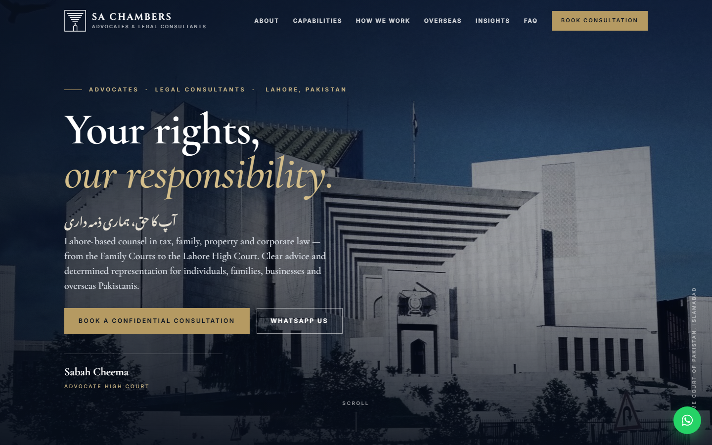
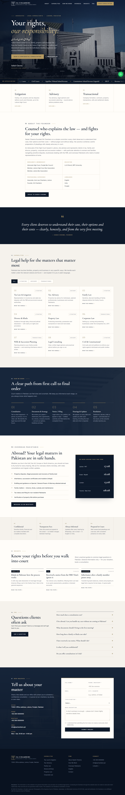
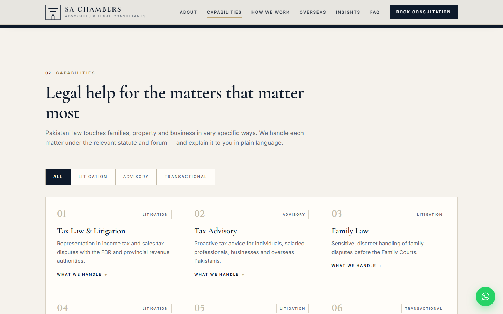
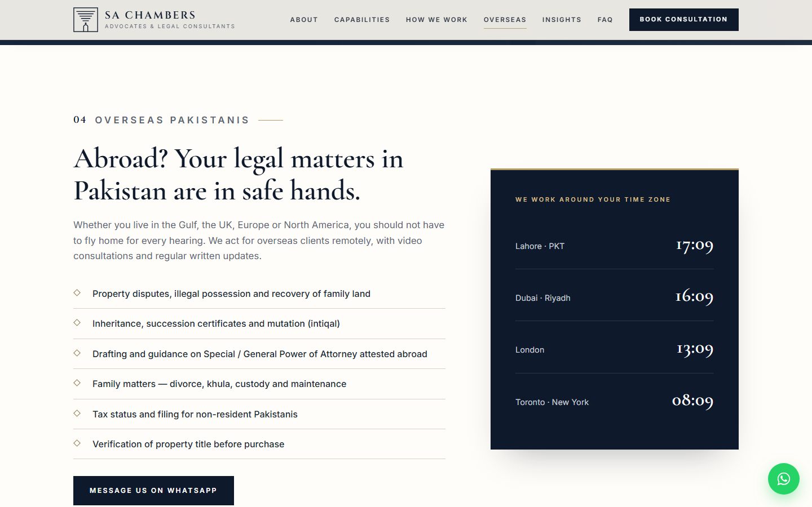
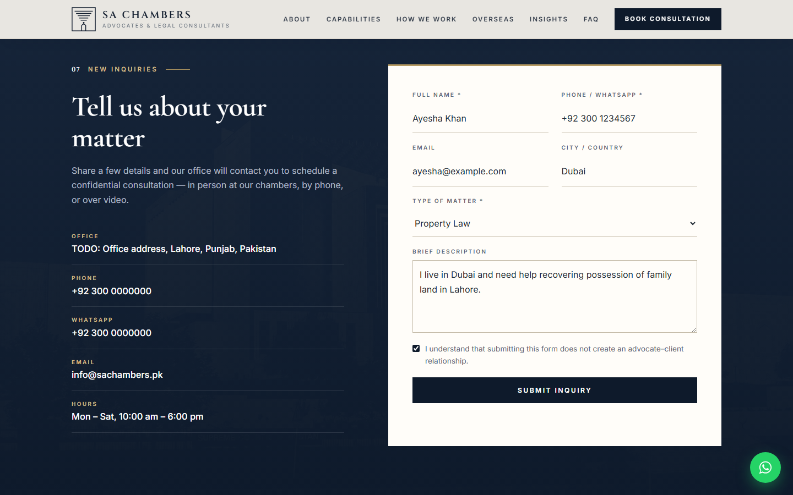
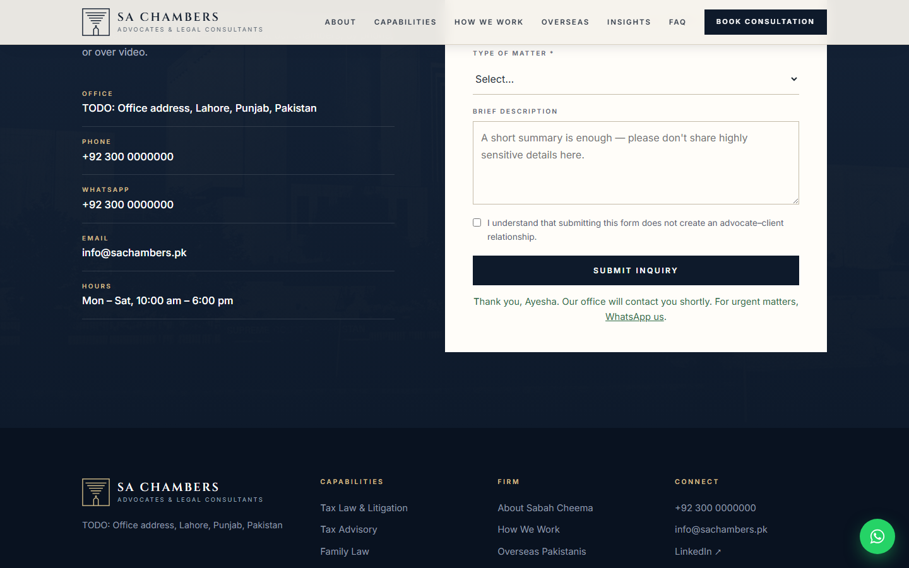
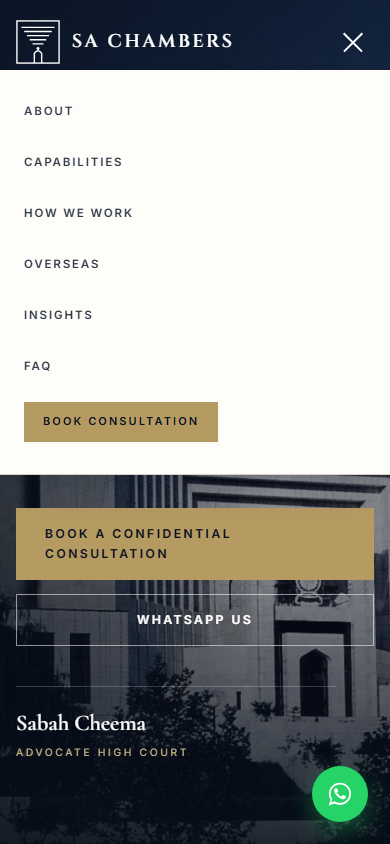

# SA Chambers — website for a Lahore law practice

I built this site for SA Chambers, an advocates and legal consultants practice in Lahore led by Sabah Cheema, Advocate High Court. The brief was a single, calm page that explains what the practice does in plain language, works just as well for an overseas Pakistani on a phone as for a client in Lahore, and lets someone book a consultation without emailing back and forth.

The whole thing is a static page served by a 67-line Node server with no dependencies. The one dynamic piece is the consultation form: submissions are validated and appended to a JSON file on the server, and the practice can read them back from a single endpoint. All the practice's details, capabilities, guides and FAQ live in one config block at the top of `app.js`, so updating the site means editing text, not markup.



## What it does

- **One-page site** with hero, courts ticker, three capability pillars, founder profile with credentials, quote band, nine practice-area cards with Litigation / Advisory / Transactional filters, a five-step "how we work" process, an overseas-clients section with live clocks for Lahore, Dubai, London and Toronto, a "why us" band, three short legal guides, an FAQ accordion, the inquiry form and a footer with the required disclaimer.
- **Consultation inquiry form.** Name, phone and matter type are required, plus an acknowledgement checkbox that submitting does not create an advocate–client relationship. The server trims and length-limits every field, stores the inquiry in `data/inquiries.json` with an id and timestamp, logs it to the console and returns a thank-you message with a WhatsApp link for urgent matters.
- **WhatsApp everywhere.** Every "WhatsApp us" button and the floating bubble open a `wa.me` link with a pre-filled greeting, built from the number in the config.
- **Content from one config.** `CONFIG` (name, title, address, phone, WhatsApp, email, hours, LinkedIn, admissions, education, experience, languages), `PRACTICE` (cards and the form's matter-type dropdown), `INSIGHTS` (guides) and `FAQ` are plain arrays in `public/app.js`; the HTML uses `data-bind` / `data-list` attributes to fill them in.
- **Bilingual touch.** The hero tagline is repeated in Urdu using Noto Nastaliq Urdu.
- **Responsive and accessible.** Burger menu below 1080px, phone layouts at 860px and 600px, keyboard-operable practice cards and FAQ, `prefers-reduced-motion` turns off the reveal animations and the ticker.

## How it works

```
server.js            Node http server: static files from public/, POST /api/inquiry, GET /api/inquiries
public/index.html    Page structure; dynamic parts are empty containers filled by app.js
public/app.js        CONFIG + content arrays, rendering, filters, nav, clocks, form submit
public/styles.css    Design: navy/gold palette, Cinzel + Cormorant Garamond + Inter, photo bands
public/img/          Supreme Court of Pakistan photographs (hero, navy duotone, portal)
data/inquiries.json  Created on the first submission; ignored by git
```

1. The server maps the request path onto `public/` (with a check that the resolved path stays inside it), guesses the content type from the extension and streams the file.
2. `POST /api/inquiry` reads up to 20 KB of JSON, cleans the fields, rejects anything missing name, phone or matter with a 422, and prepends the entry to the JSON store.
3. `GET /api/inquiries` returns the store as JSON. There is no authentication on it, so this is meant for a local or private deployment; put it behind auth or remove it before exposing the site publicly.
4. On the page, `app.js` binds the config into the DOM, builds the practice cards, matter dropdown, footer list, guides and FAQ, wires the filters and accordions, and reveals sections with an `IntersectionObserver` as they scroll into view.

## Stack

| Layer | Choice |
|---|---|
| Server | Node.js, built-in `http` / `fs` / `path` only |
| Store | `data/inquiries.json` |
| Front end | Hand-written HTML, CSS and vanilla JS, no build step |
| Fonts | Google Fonts: Cinzel, Cormorant Garamond, Inter, Noto Nastaliq Urdu |
| Images | Supreme Court of Pakistan photographs via Wikimedia Commons (CC BY-SA), credited in the footer |

## Run it locally

```bash
git clone https://github.com/ashhhadd-210/sa-chambers.git
cd sa-chambers
node server.js            # or: PORT=8080 node server.js
```

Open <http://localhost:4700>. Nothing to install and no credentials are needed.

The contact details in `CONFIG` at the top of `public/app.js` are placeholders (`+92 300 0000000`, `TODO: Office address`) marked with `TODO` comments; replace them with the practice's real details before deploying. Inquiries are written to `data/inquiries.json`, which is git-ignored because it contains client contact details.

## Screenshots

The full page from hero to footer.



Capabilities: nine practice-area cards with category filters; each card expands to list what the practice handles.



The overseas-clients section with live clocks for Lahore, the Gulf, London and Toronto.



The consultation form filled in, and the confirmation after it is submitted.





Phone width: hero and the burger menu.



